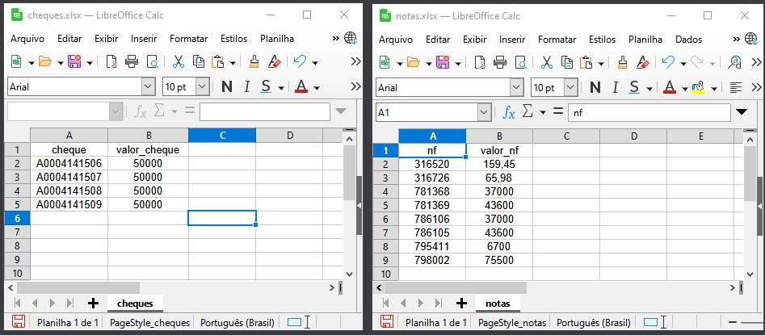
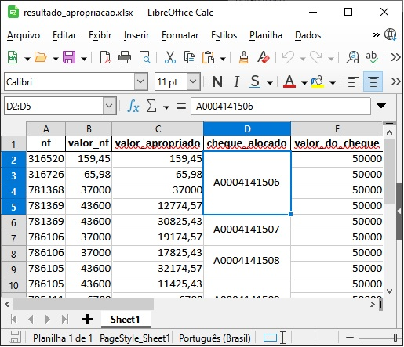

# 🧾 Alocador Automático de Cheques por Notas Fiscais


[](https://colab.research.google.com/github/amisadaimodesto/apropriarCheque_python/blob/main/notebooks/demo_apropriacao_cheques.ipynb)

Automação financeira desenvolvida em Python para **conciliação e rateio (apropriação) de valores de cheques/créditos em Notas Fiscais (NFs)**...
Automação financeira desenvolvida em Python para **conciliação e rateio (apropriação) de valores de cheques/créditos em Notas Fiscais (NFs)**. O motor processa planilhas de entrada respeitando rigorosamente a ordem cronológica (FIFO) e o saldo remanescente de cada título, gerando um relatório executivo em Excel com formatação contábil e células mescladas para auditoria rápida.

---

## 🎯 Problema de Negócio & Solução

* **O Gargalo:** O cruzamento manual entre múltiplos cheques (ou créditos de fomento/subsídio) e dezenas de notas fiscais exige controle rigoroso de saldos parciais, gerando alto risco de erro humano e retrabalho na prestação de contas[cite: 5].
* **A Solução:** Um pipeline determinístico em Python que lê os lotes de entrada (`cheques.xlsx` e `notas.xlsx`), executa a baixa proporcional até zerar os saldos disponíveis e exporta a memória de cálculo pronta para conferência contábil[cite: 5].

---

## ⚙️ Arquitetura do Fluxo

```text
[ data/input/notas.xlsx ]   ──┐
                              ├──▶ [ src/apropriar_cheque.py ] ──▶ [ data/output/relatorio_apropriado.xlsx ]
[ data/input/cheques.xlsx ] ──┘      (Motor FIFO & Reconciliação)       (Relatório Contábil Formatado)
```

---

## 📊 Demonstração (Entrada vs. Saída)

### 1. Bases de Entrada (`notas.xlsx` e `cheques.xlsx`)


### 2. Relatório Consolidado Gerado


---

## 🚀 Como Executar

1. **Clone o repositório:**
   ```bash
   git clone [https://github.com/amisadaimodesto/apropriarCheque_python.git](https://github.com/amisadaimodesto/apropriarCheque_python.git)
   cd apropriarCheque_python
   ```

2. **Crie o ambiente virtual e instale as dependências:**
   ```bash
   python3 -m venv .venv
   source .venv/bin/activate  # No Windows: .venv\Scripts\activate
   pip install -r requirements.txt
   ```

3. **Execute o motor de apropriação:**
   ```bash
   python src/apropriar_cheque.py
   ```